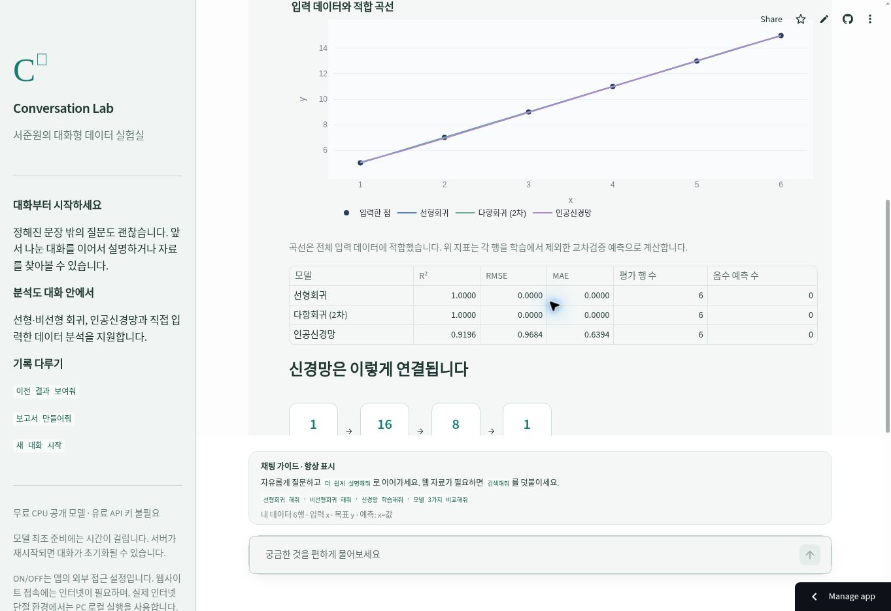
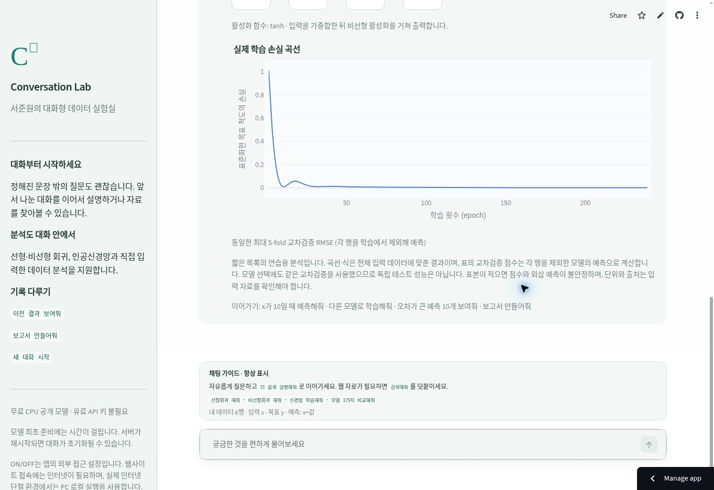
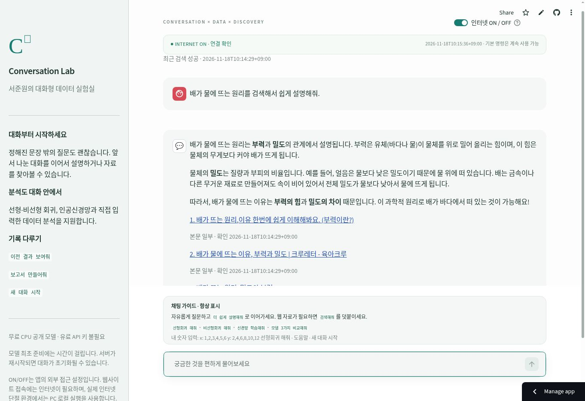

서준원 · 동아대학교 조선해양공학과 · 데이터처리개론

## 과제 개요

이번 과제에서는 기존 선형회귀·비선형회귀·인공신경망 프로그램에 공개 LLM의 대화 기능을 연결했다. 정해진 분석 명령뿐 아니라 일반적인 질문도 입력할 수 있고, 인터넷을 켜면 웹 자료를 찾아 답변에 참고한다. 이전 과제의 제출물을 보존하기 위해 저장소와 실행 사이트를 새로 만들었다.

[프로그램 실행](https://junwon-conversation-lab.streamlit.app/) · [GitHub 소스 코드](https://github.com/junwon1901-lab/junwon-conversation-lab)

11월 6일 강의 녹취의 39:13~40:52에서는 공개 LLM을 선택해 다운로드·설치하고 웹사이트에 대화창을 붙이는 과제가 설명된다. 인터넷 스위치와 검색 기능은 여기에 추가한 기능이다. 이 보고서는 녹취 텍스트를 참고했으며 원본 음성을 직접 청취한 기록은 아니다.

## 대화와 학습의 구분

대화 모델은 Qwen3-1.7B의 Q4_K_M 양자화 파일을 사용한다. 무료 CPU 서버에서 실행하며 유료 API 키는 필요 없다. 처음 일반 질문을 하면 약 1.28 GB 모델을 내려받고 파일의 무결성을 확인한다.

질문을 받을 때 최근 대화와 필요한 검색 자료를 함께 넣어 답변을 생성한다. 따라서 같은 대화에서 앞선 내용을 이어서 질문할 수 있다. 다만 검색할 때마다 모델 가중치가 바뀌는 자동 재학습은 아니다. 웹 검색을 답변의 참고 자료로 사용하는 검색 증강 생성(RAG)에 해당한다.

회귀와 신경망의 수치 계산은 LLM이 답을 추측하지 않도록 기존 Python 함수에서 처리한다. 생성된 Python 코드를 임의로 실행하는 기능은 없다.

## 데이터와 분석 방법

기본 데이터는 Caprace·Fahrnholz의 Sailboat Hull Resistance Dataset and Predictive Model, v4(CC BY 4.0)다. 기존 과제에서 정리한 1,018행, 70개 선형 데이터를 사용한다. 입력은 Fn, Rn, Cp, Cb, Cw, L/B, B/T, LCB/L이고 출력은 정규화 저항 Rt/Δ × 10³이다. 출력값은 힘의 단위 N이 아니다.

[데이터 원문](https://doi.org/10.17632/gw23dgzn6h.4)

선형회귀는 잔차제곱합을 최소화한다. 다항회귀는 입력의 제곱·교차항을 만들어 비선형 관계를 표현하며, 기본 데이터에는 Ridge 규제를 적용한다. 기본 인공신경망은 8→64→32→16→1 구조와 ReLU 활성화함수, Adam 최적화를 사용한다. 같은 선박의 행이 학습·검증·테스트에 섞이지 않게 분할하고, 검증 RMSE로 모델을 선택한다. 스케일러는 학습 데이터에만 적합한다.

직접 입력한 짧은 숫자 목록은 별도로 처리한다. 6~29개 자료에는 최대 5-fold 교차검증을 사용하고, 신경망은 1→16→8→1 구조와 tanh를 사용한다. 작은 표본의 좋은 점수가 새로운 데이터에서도 성능을 보장하지는 않는다.

## 사용 순서

1. 사이트에 접속한다. 절전 화면이 나오면 깨우기 버튼을 누른다.
2. 일반 질문은 인터넷 ON에서 입력한다. 첫 대화에는 모델 준비 시간이 필요하다.
3. 웹 자료가 필요하면 질문 끝에 `검색해줘`를 붙인다. 답변 아래 출처와 확인 시각을 볼 수 있다.
4. `더 쉽게 설명해줘`처럼 후속 질문을 입력한다.
5. 직접 분석하려면 아래 예시를 채팅창에 넣는다.

```text
x: 1,2,3,4,5,6 y: 5,7,9,11,13,15 선형회귀 해줘
```

이후 `x가 10일 때 예측해줘`, `비선형회귀 해줘`, `신경망 학습해줘`, `모델 3가지 비교해줘`로 이어갈 수 있다. CSV·탭 구분 표는 `데이터 입력` 다음 줄부터 붙여 넣고 마지막 열을 목표값으로 사용한다(30~1000행). `기본 데이터 사용`으로 선체 데이터로 돌아간다.

분석 실행 버튼은 두지 않았고 채팅 가이드는 입력창 위에 고정했다. 인터넷 ON/OFF만 스위치로 조작한다. OFF는 앱의 외부 검색·다운로드를 막는 설정이며 기기의 Wi-Fi를 끄는 기능은 아니다. 웹사이트 접속 자체에는 인터넷이 필요하다. 실제 통신이 끊긴 PC에서는 패키지를 미리 설치한 뒤 로컬 실행한다.

## 실제 계산 결과

다음은 실행 스크립트 `scripts/verify_analysis.py`에서 계산한 결과다. 공개 데이터는 학습 640행, 검증 176행, 테스트 202행으로 나뉜다.

| 모델 | 검증 RMSE | 테스트 R² | 테스트 RMSE | 테스트 MAE |
|---|---:|---:|---:|---:|
| 선형회귀 | 15.4443 | 0.8044 | 22.9112 | 18.0864 |
| 2차 다항회귀 | 12.8315 | 0.8925 | 16.9841 | 12.4935 |
| 인공신경망 | 9.8529 | 0.9259 | 14.1035 | 8.0103 |

이 설정에서는 인공신경망의 검증 RMSE가 가장 작았다. 테스트의 음수 예측은 선형회귀 43개, 다항회귀 19개, 신경망 0개였다. 저항이 음수인 예측은 물리적으로 사용할 수 없으며, R²가 높다고 모든 개별 예측이 정확한 것은 아니다. 이는 11월 6일 녹취 42:43 이후의 수치 예측 오차에 관한 지적과 연결된다.

직접 입력한 6개 점은 y=2x+3 관계를 가진 확인용 예시이며 공개 실험 자료가 아니다. 공개 사이트에서 인터넷 OFF로 실행한 결과 선형식 y=2x+3, x=10의 예측값 23을 확인했다. 세 모델의 교차검증 RMSE는 선형 약 0, 다항 약 0, 신경망 0.9684였다. 이처럼 관계가 단순한 작은 데이터에서는 복잡한 신경망이 항상 유리하지 않았다.

## 검증과 한계

기존 계산, 직접 입력값, 네트워크 OFF 차단, 화면 동작을 포함한 자동 테스트 54개가 통과했다. OFF 검사에서는 소켓 연결과 DNS 조회가 호출되면 실패하도록 설정하고 세 분석 모델과 예측이 실행되는지 확인했다. 검색 실패 안내와 실제 출처가 없는 인용번호 제거도 검사했다. 이 테스트 수는 모든 질문의 답변 정확도를 뜻하지 않는다.

공개 사이트에서 일반적인 발표 준비 질문에 Qwen3가 답변하는 것을 확인했다. 소형 모델은 설명이 어색하거나 질문의 일부를 놓칠 수 있으므로 상용 대형 챗봇과 같은 수준을 보장하지 않는다. 검색 자료의 요약도 원문과 대조해야 한다. 서버 절전·초기 모델 준비·CPU 추론 때문에 지연이 생길 수 있고, 서버 재시작이나 새 세션에서는 대화가 초기화될 수 있다.

## 실행 화면







검색 실행에서는 자료 3개를 받아 본문 일부 2개와 검색 요약 1개를 구분해 표시했다. 위 화면은 실제 생성 답변이다. 다만 “부력이 무게보다 커야 뜬다”는 표현은 정지해서 떠 있는 평형 상태에는 맞지 않는다. 평형에서는 부력과 무게가 같고, 위로 가속할 때 순힘이 위쪽으로 작용한다. 검색 성공을 과학적 정확성의 보장으로 해석하면 안 된다.

## AI 활용 범위

대화 중심 구성, 인터넷 ON/OFF, 기존 기능 유지, 이전 제출물과의 분리는 사용자가 정한 요구사항이다. 구현·수정·검증 코드와 문서 초안에는 AI를 활용했다. 위의 수치는 실제 Python 실행 결과이며, 웹 화면 검증은 자동화된 브라우저로 수행했다. 사용자가 직접 실행하지 않은 시험이나 개인적인 소감을 수행한 것처럼 쓰지 않았다.

## 설명할 수 있어야 할 질문

- 인터넷 검색과 모델 가중치 학습은 어떻게 다른가?
- 인터넷 OFF에서도 회귀·신경망 분석이 가능한 이유는 무엇인가?
- 검증 데이터와 테스트 데이터를 나누는 이유는 무엇인가?
- 선체 저항 예측이 음수가 나오면 어떻게 해석해야 하는가?
- 작은 데이터에서 선형회귀가 신경망보다 잘 맞을 수 있는 이유는 무엇인가?

## 참고자료

- `2026. 11. 6. 데이터처리개론.txt`: 39:13~40:52(LLM 과제), 10:38~12:37(데이터 분할), 42:43 이후(수치 예측 오차).
- [Qwen3 공개 모델](https://huggingface.co/Qwen/Qwen3-1.7B-GGUF)
- [사용한 양자화 파일](https://huggingface.co/bartowski/Qwen_Qwen3-1.7B-GGUF)
- [llama-cpp-python](https://github.com/abetlen/llama-cpp-python)
- [DDGS 검색 도구](https://github.com/deedy5/ddgs)
- [고정 하단 영역 문서](https://docs.streamlit.io/develop/api-reference/layout/st.bottom)


# 11월 20일 강의 반영: 실행 결과를 돌려받는 대화형 분석

서준원 · 데이터처리개론

## 강의에서 바뀐 과제의 중심

`2026. 11. 20. 데이터처리개론.txt` 녹취 텍스트를 확인했다. 단순히 질문에 답하거나 코드를 작성하는 챗봇에서 끝내지 않고, 이미 만든 프로그램을 실제로 작동시키는 데 초점을 맞췄다. 아래 시각은 녹취의 시각이며 원본 음성을 직접 확인한 것은 아니다.

| 구분 | 강의 내용 | 이번 반영 |
|---|---|---|
| 필수 중심, 06:07·08:31~09:19 | LLM으로 기존 회귀·신경망과 그 데이터를 실제로 사용 | 자연어 요청을 허용된 분석 함수로 연결, 직접 입력값 분석 유지 |
| 연결 원리, 07:48·23:17 | API 연결과 실행 결과의 LLM 반환 | 검증된 함수 인터페이스, 실행 영수증, 같은 요청 안에서 결과 해석 |
| 기능 강화, 13:22~17:17 | 명령 수행, 기억, 분야별 문서 활용·RAG | 문서 조각 검색, 출처 표시, 명시적 대화 기억 |
| 개선 요구, 11:48~12:39 | 소형 모델이 부정확하다는 설명에서 끝내지 않기 | 근거 문서 제공, 기존 부력 설명 오류를 재검증 대상으로 선정 |
| 이해도, 18:59~20:44·23:17 | 답안을 본인의 코드와 비교 | 함수별 학습 가이드와 설명 질문 작성 |

05:15에는 공개 웹사이트 방식도 허용하는 취지의 설명이 있다. 무료 Streamlit 배포는 유지했다. GPU 구입이나 대형 모델 설치는 확장 예시로 판단했으며 필수 조건으로 추가하지 않았다. 17:17에는 **11월 말까지**라고 언급한다. 정확한 마감일·시각은 LMS에서 확인해야 한다.

## 구현 방법

사용자 요청 → LLM의 구조화된 동작 선택 → 허용 목록·입력 검증 → Python 실행 → 실제 실행 결과 반환 → LLM 해석 순서다. 숫자를 명시적으로 입력한 기존 명령은 숫자가 잘못 옮겨지는 것을 막기 위해 먼저 파싱한다. 이 경우에도 실행 결과는 준비된 LLM에 전달한다.

`conversation/tools.py`의 `validate()`는 동작, 2·3차 차수, 유한한 예측값을 검사한다. `run_tool()`은 기존 `llm_lab/agent.py`의 `execute_plan()`을 호출하고 결과를 `ConversationModel.explain_tool()`에 보낸다. 이는 **프로세스 내부 함수 API**이며 외부 REST 서버를 새로 만든 것은 아니다. 임의의 생성 코드나 셸 명령을 실행하지 않는다.

영수증에는 실행 ID, 시각, 동작·인수, 데이터 행 수·지문, 실행 상태, 분석 기록 또는 실제 예측값이 담긴다. Python이 계산한 결과를 그대로 표시하고 LLM의 해석은 별도로 표시한다. 해석 생성에 실패해도 계산을 다시 실행하거나 계산값을 덮어쓰지 않는다. OFF이며 모델이 준비되지 않았다면 Python 결과만 제공한다.

## 문서와 기억

`conversation/knowledge.py`는 등록 문서를 600자씩 나누고 이웃 조각을 150자 겹치게 한다. 질문과 문서의 문자 2~4그램 TF-IDF 벡터를 비교해 유사도 0.08 이상인 조각 중 최대 3개를 가져온다. 검색한 본문·제목·출처·조각 번호를 답변과 함께 표시한다. 한국어 띄어쓰기 차이를 일부 흡수할 수 있고 별도의 임베딩 서버나 API 비용이 들지 않는다. 의미가 같아도 표현이 크게 다르면 검색을 놓칠 수 있다.

기본 자료는 수업 요구사항 요약, 실제 코드의 회귀·신경망 구조, 검증 데이터의 역할, 선체 데이터 단위, 부력 평형 보충 설명이다. 강의 원본 전체를 공개 저장소에 올리지 않았다. 보충 설명을 교수님의 직접 발언으로 표시하지 않았다.

사용자가 등록한 문서의 사실 여부는 검증된 것으로 취급하지 않는다. 자료와 기억은 참고 데이터로 전달하며, 문서 안의 실행 지시를 도구 명령으로 사용하지 않는다. 자료는 대화별 최대 10개, 각 12,000자이고 기억은 최대 10개, 각 300자다. 모델의 입력 한도를 위해 일반 답변에 들어가는 별도 기억은 최근 3개, 각 150자이며 전체 목록은 `기억 보여줘`로 볼 수 있다. 새 대화·서버 재시작 후 복원은 보장하지 않는다. **문서 검색과 기억은 LLM 가중치 재학습이 아니다.**

## 따라 해볼 순서

1. `x: 1,2,3,4,5,6 y: 5,7,9,11,13,15`를 입력한다. 이는 확인용 합성 데이터다.
2. `이 데이터로 직선 모델을 학습시켜서 오차가 얼마나 되는지 알려줄래?`라고 요청한다.
3. `x가 10일 때 예측해줘`로 이어간다. 정확한 선형 관계는 y=2x+3이므로 계산값은 23이다. x=10은 학습 범위 밖이라는 점도 확인한다.
4. `비선형회귀 해줘`, `신경망 학습해줘`, `모델 3가지 비교해줘`로 기존 기능을 확인한다.
5. 아래 문서를 채팅에 등록한 뒤 `실험선 A의 전장은 얼마이고 시험 조건은 뭐야?`라고 묻는다.

```text
자료 등록: 실험선 A
실험선 A의 전장은 42미터이고 시험 조건은 담수이다. 목표 속도는 3노트이다.
```

6. `기억해: 내 발표 주제는 선체 저항이야`를 입력하고 주제를 다시 묻는다.
7. 인터넷 OFF로 바꾸고 분석과 등록 문서 검색이 계속되는지 확인한다. 모델 미준비 시 자료 원문을 보여주는 동작은 LLM 답변과 구분된다.

`자료 목록`, `자료 삭제: 실험선 A`, `기억 보여줘`, `기억 삭제`를 지원한다. 분석 버튼은 추가하지 않았고 입력창 위 가이드를 유지했다.

## 코드와 연결해서 설명할 질문

1. LLM이 “실행했다”고 말하는 것과 실제 실행은 어떻게 구분하는가? — `conversation/tools.py`의 실행 상태와 실제 결과 영수증, `llm_lab/agent.py`의 호출을 확인한다.
2. 선형회귀는 무엇을 최소화하며 RMSE와 R²는 무엇인가? — `llm_lab/analysis.py`와 `llm_lab/small_sample.py`에서 적합 함수와 지표 계산을 연결한다. R²를 정답률로 설명하지 않는다.
3. 내 신경망의 입력·층·활성화함수는 무엇인가? — 기본 데이터는 `analysis.config()`의 8→64→32→16→1, ReLU·출력 identity다. 짧은 직접 입력은 1→16→8→1, tanh다. 두 경로를 혼동하지 않는다.
4. 과적합·데이터 누수를 어떻게 줄이는가? — `models/neural_network.py`의 `split_indices()`, 학습 데이터만 사용한 스케일러, `train_network()`의 검증 손실·조기 종료, `evaluate_test_set()`을 설명한다. 역전파와 Adam 업데이트는 scikit-learn의 MLPRegressor가 수행한다.
5. RAG와 대화 기억은 학습인가? — 문서 조각과 기억을 매번 입력에 넣는 것이며 LLM 가중치 변경은 없다. 검색 실패와 생성 오류는 여전히 가능하다.

## AI 활용 및 남는 한계

사용자가 정한 무료 배포·대화 중심·기존 과제 보존 조건에 따라 AI가 코드와 테스트·문서 초안을 작성했다. 실제 실행 기록과 대역을 사용한 자동 테스트는 구분해 기록한다. 사용자가 직접 했다고 확인되지 않은 실험·소감은 쓰지 않는다. 소형 CPU 모델의 지연, 자연어 동작 선택 오류, 검색 자료의 부정확성 가능성은 남으므로 중요한 결론은 계산 원문·출처와 대조한다.

이전 1·2차 GitHub·Streamlit·Notion은 수정하지 않는다. 이번 변경 대상은 `junwon-conversation-lab`과 해당 보고서다.
